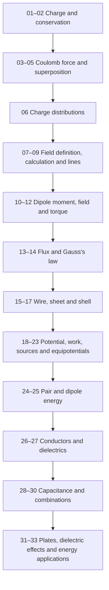

# Fieldwork · Unit I course specification

**Build:** 2.0, 7 October 2026. **Scope:** CBSE Class XII Physics 042, 2026–27, Unit I only. The current entry is [unit-1-preview.html](unit-1-preview.html). This specification supersedes the earlier four-screen simulation prototype.

## Learning architecture

All **33 topics** have authored teaching and practice. Chapter 1 has 17 lessons; Chapter 2 has 16. The sidebar and course page show the entire sequence. Every row opens a real lesson.

1. **Understand:** objective, optional foundation bridges, intuition, explanation, annotated diagram, formulas and their conditions, connected reasoning, graph where useful, misconception correction.
2. **Worked example:** question first, then one solution step at a time. Every reveal is a chance to predict the next step.
3. **Your turn:** a guided choice or numeric question with feedback, followed by an independent written attempt and solution comparison. The worked-example setup remains available for questions that refer to it.
4. **Board answer:** a topic-specific written question, answer draft or paper-attempt record, and an explicit checklist of the expected physics points. The checklist is original practice, not an official scheme.
5. **Recall and check:** retrieve an answer before revealing it, then take a concept MCQ. The lesson record shows which evidence is still missing.

Stages can be revisited freely. A checkpoint requires recorded reading, every worked step, a correct guided answer, an independent attempt and review, all board points self-reviewed, recall attempted, and a correct concept check. The interface calls this a **checkpoint**, not proof of exam mastery. A failed recheck withdraws the passed checkpoint.

## Topic sequence

Early force lessons do not require a prior field definition. Continuous distributions are introduced through charge density and Coulomb contributions; the electric-field integral is developed after the field definition. Eight bridges support units, vectors, inverse-square scaling, work and energy signs, trigonometry, integration as a sum, graph slope and algebra.

## Board preparation

The bank has **81 original questions**: 33 lesson MCQs, 33 lesson written tasks, 8 integrated four-part case studies, 4 additional five-mark questions and 3 assertion–reason questions. Cases collectively map all 33 topics. Chapter and question-format filters open the relevant selection.

The two chapter tests each total 20 marks: four MCQs, two 2-mark questions, one 3-mark question, one 4-mark case and one 5-mark question. Answers appear after attempts are recorded. MCQs are checked automatically; written marks are entered by the learner after rubric comparison. A chapter test samples concepts and is not presented as a full 70-mark Physics mock.

The current official sample-paper references are Q1, Q16, Q19, Q31(A) and Q31(B). Each links to the appropriate original paper page and the official marking scheme. No previous-year-paper provenance is fabricated; verified PYQ inventory remains empty.

## Representations

| Family | Implemented diagrams | Graphs / controls |
| --- | --- | --- |
| Charge and force | Sign interactions, conserved totals, pair forces, target force contributions, vector components | Inverse-square graph; distance control |
| Distributions and field | Density element, force versus field, radial vectors, uniform field lines | Point-field inverse-square graph |
| Dipoles | Charge separation and moment, axial/equatorial directions, torque geometry | Far-field magnitudes, torque versus angle |
| Flux and Gauss | Area normal, enclosed/external charges, cylindrical surface, sheet pillbox, concentric shell | Flux versus angle and control; wire, sheet, shell fields |
| Potential and energy | Point source, endpoint work, dipole cancellation, scalar source sum, equipotentials, pair separation | Potential versus distance, potential slope, pair energy, dipole energy |
| Materials and capacitors | Conductor equilibrium, bound dipoles, plate geometry, series and parallel nodes | Q–V, capacitance versus gap, energy versus voltage; connected/isolated dielectric control |

Graphs state their fixed quantities and normalisations. Shell field uses separate inside/outside curves with open endpoints at the ideal surface. A representation is accompanied by text; its arrows are not presented as particles or field lines as physical objects.

Capacitor-energy reasoning is an application procedure. The current “formulae only, no derivation” scope is retained. Dielectric outcomes identify fixed Q versus fixed V explicitly.

## Visual and interaction system

A quiet reading workspace uses serif headings, system sans-serif body text, lavender (`#eee8f7`, `#6e529f`), cyan (`#e1f2f4`, `#197181`) and restrained dividers. Content, equations and scientific diagrams carry the visual hierarchy.

Desktop has a complete topic sidebar, the reading column and a small objective/source margin. At narrower widths the margin moves below the lesson; mobile uses a dismissible sidebar and a single reading column. Forms have visible labels, diagrams have accessible descriptions, controls have keyboard focus styles, and reduced-motion preferences remove transitions. Physical signs and directions are expressed in text as well as colour.

## Content, state and provenance

Plain JavaScript content files load with classic scripts, so the course works from a local HTML file without fetching lesson data. Each lesson and question carries session, board, class, subject code, chapter, concept, syllabus status, source, source version, verification date and review status. The board task uses the distinct `boardTask` key so it cannot overwrite the `board: CBSE` metadata.

Local storage key `fieldwork-2026-27-v2` stores lesson state, drafts, checked answers, mistakes and chapter-test reviews. No student account or personal-data collection is used. If storage is blocked, the app says that work may not persist. Stored answer text is escaped when rendered.

The [manifest](../curriculum/unit-1-manifest.json) links each syllabus item to implemented routes, diagrams, graphs, formula conditions and integrated assessments. `authored`, `verified` and `published` remain distinct. No topic has been marked human-verified.

## Validation and remaining review

- Offline content validation checks every topic, required component, metadata field, question reference and diagram/graph renderer.
- Numeric guided answers are independently recalculated from their givens; representative integrated calculations and limiting dipole expressions are checked.
- Controller checks exercise progressive examples, attempted-answer gates, correct/incorrect feedback, checkpoint withdrawal, local state, dielectric constraints, flux signs and chapter-test scoring.
- Generated pages are checked for balanced tags, unique IDs, associated form labels, valid lesson links and official-source hosts.
- Browser layout and real assistive-technology behaviour remain untested because local-file browser automation was restricted. This is recorded rather than represented as a passed visual check.
- Human physics-editor review and novice learner observation remain necessary before a production launch. No score guarantee is made.
